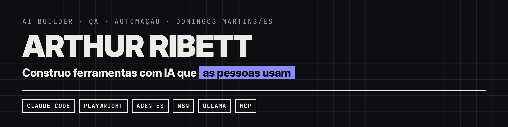

### Construo com IA as ferramentas que eu mesmo uso no trabalho.

Analista de QA na **E&L Produções de Software**, onde criei o **Alfredo**, um robô de testes ponta a ponta escrito com Claude Code e Playwright. Ele percorre mais de 100 telas do sistema sozinho e já faz parte da rotina do time. Fui promovido do Atendimento a QA em 3 meses. Ex-cofundador da COREX Studios. Inglês fluente.

**Portfólio →** https://arthurribettm.github.io &nbsp;·&nbsp; **LinkedIn →** https://www.linkedin.com/in/arthurribettm

---

#### O que construí

| Projeto | O que faz | Stack | Status |
|---|---|---|---|
| **Alfredo** · E&L | Robô de QA que testa o sistema em qualquer horário e publica o resultado em painel próprio; pedido de merge em um clique (50 testes) | `Claude Code` `Playwright` `TypeScript` `Apps Script` | 🟦 Em uso |
| **Cérebro COREX** | Base de conhecimento lida pelo Claude via MCP + sistema de skills que coordena vários chats | `Claude` `MCP` `Obsidian` | Encerrado em set/2026 |
| **Bot COREX-Setup** | Bot de Discord com Claude Haiku que responde sobre o cérebro, separando contexto público e privado por canal (~R$0,90/mês) | `Discord.js` `Claude Haiku` `PM2` | Encerrado em set/2026 |
| **WebPresence** | Sites e protótipos gerados com Claude Code, mostrados na ligação de venda | `Next.js` `Tailwind` | Encerrado em set/2026 |
| **LeadStream** | Prospecção B2B: LLM dá nota de 0 a 100 e sugere a mensagem | `n8n` `LLM` | Piloto pausado |
| **Estação de IA 24/7** | Agente no Telegram que aciona o Claude Code e versiona tudo em Git | `Claude Code` `Telegram` `Git` | 🟦 Em uso |
| **Ordem do Dia** | App de estudos do zero ao deploy | `React` `Supabase` `Vercel` | Deploy feito |
| **Atlas Sports** | Catálogo online com pedido direto pelo WhatsApp | `Netlify` | 🟦 No ar |

> O código da E&L e da COREX não é público. Os estudos de caso no portfólio descrevem problema, solução e resultado, sem código, dados ou nomes de clientes.

#### Ferramentas

```
IA          Claude Code · Codex · Claude API · Ollama · Kimi · MCP · prompt engineering · orquestração de agentes
Automação   n8n · Google Apps Script · Playwright · webhooks · PM2
Build       Cursor · v0 · Bolt · Replit · React · Next.js · Tailwind · Supabase · Vercel · Netlify · Node.js
QA / Dev    Git · Maven · testes funcionais e de regressão
```

Estudo Análise e Desenvolvimento de Sistemas na UniBF · Domingos Martins/ES · remoto (UTC-3)
